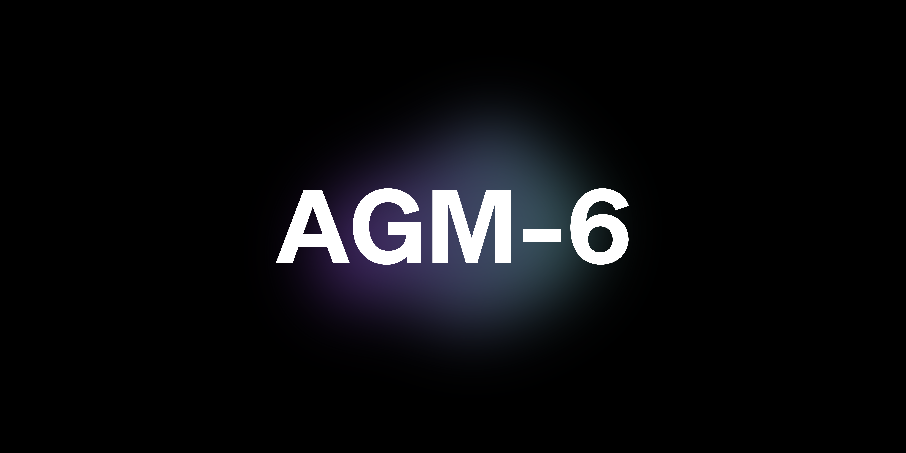

# AGM 6



AGM 6 and AGM 6 Lite run locally. Lite optionally uses a calculator, clock, and season lookup.

```sh
git lfs pull
python -m pip install torch tokenizers safetensors
python server.py
```

The server opens the chat in your browser at `http://127.0.0.1:8785`. Use `--device cpu` to force CPU inference. Select either model in the browser, or run `python agm_6_runner.py "Hello"` or `python agm_6_lite_runner.py --tools` from this folder.

The AGM application code is distributed under the Apache License, Version 2.0. See [LICENSE](LICENSE).
